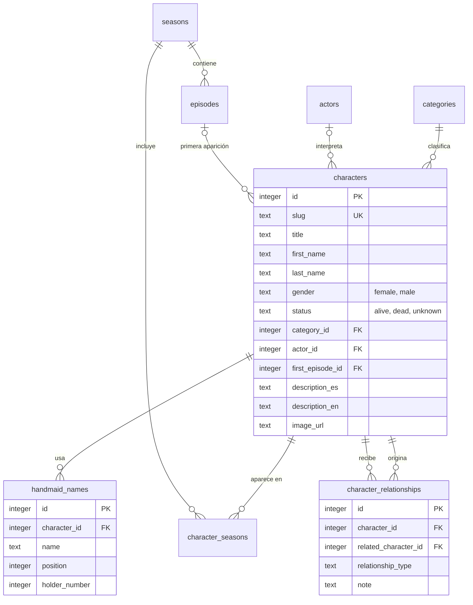

# The Handmaid's Tale · Character Database

Base de datos interactiva de los personajes de *The Handmaid's Tale*. Se pueden buscar, filtrar, ordenar y explorar sus relaciones, en español o en inglés.

Los datos viven en una base **SQLite propia** y se sirven mediante una **API REST propia**. No se usa Wikipedia, Wikidata, ninguna API de terceros ni ningún servicio externo de datos.

> Proyecto de fans, hecho con fines de aprendizaje y portfolio. No tiene afiliación con la serie ni con sus titulares, y no incluye imágenes de la serie.

---

## Contenido

- [Objetivo](#objetivo)
- [Funcionalidades](#funcionalidades)
- [Tecnologías](#tecnologías)
- [Arquitectura](#arquitectura)
- [Estructura del proyecto](#estructura-del-proyecto)
- [Modelo de datos](#modelo-de-datos)
- [API REST](#api-rest)
- [Instalación y ejecución](#instalación-y-ejecución)
- [Cómo agregar personajes](#cómo-agregar-personajes)
- [Decisiones técnicas](#decisiones-técnicas)
- [Limitaciones conocidas](#limitaciones-conocidas)

---

## Objetivo

Construir una aplicación pequeña pero completa, con la estructura de un proyecto real, para practicar y demostrar:

- Modelado de datos relacional y consultas SQL reales (JOINs, subconsultas, `EXISTS`, agregaciones, restricciones).
- Un backend sencillo con capas separadas y validación de parámetros.
- Un frontend en React con rutas, estado en la URL, componentes reutilizables y manejo de todos los estados de la interfaz.

La prioridad fue el código claro y la arquitectura legible por encima de sumar tecnologías: no hay librerías de estado, de fetching ni de internacionalización.

## Funcionalidades

- **Búsqueda** por nombre, apellido, nombre de Handmaid (cualquiera de los que haya tenido) y actor/actriz. Se resuelve en SQL, no en el navegador.
- **Filtros combinables** por estado (vivo, muerto, desconocido), categoría y temporada.
- **Ordenamiento** por nombre (A → Z y Z → A), primera aparición, estado y categoría.
- **Paginación** desde el backend, que funciona junto con la búsqueda, los filtros y el orden.
- **Ficha individual** con estado, categoría, actor/actriz, primera aparición, temporadas, descripción y relaciones con otros personajes (con dirección, por ejemplo "superior" / "a su cargo").
- **Fotos de los personajes**: se copian a una carpeta (`backend/images/characters/`) con el nombre del personaje y aparecen solas, sin tocar la base de datos. Se ven en la ficha y como miniatura en el listado.
- **Estado con concordancia de género en español**: "Viva" / "Vivo", "Muerta" / "Muerto", "Desconocida" / "Desconocido".
- **Nombres de Handmaid múltiples y numerados**: "Ofjoseph #3" es la tercera criada en llevar ese nombre.
- **Interfaz en español e inglés**, con un selector que recuerda la elección.
- **Filtros en la URL**: cada búsqueda se puede compartir, y el botón "atrás" del navegador funciona.
- **Estados de la interfaz**: esqueletos de carga, error de conexión con "Reintentar", sin resultados con "Limpiar filtros", página fuera de rango, personaje inexistente, ruta inexistente y una pantalla de error general ante fallos inesperados.
- **Datos incompletos tratados con honestidad**: lo que no se sabe se guarda como `NULL` o `unknown` y se muestra como "Desconocido".

## Tecnologías

| Capa | Tecnología |
|---|---|
| Base de datos | SQLite (a través de `better-sqlite3`) |
| Backend | Node.js, Express 5 |
| Frontend | React 19, Vite 8, React Router 7 |
| Estilos | Tailwind CSS 4 |
| Lenguaje | JavaScript (sin TypeScript) |

Dependencias de ejecución: `express` y `better-sqlite3` en el backend; `react`, `react-dom` y `react-router-dom` en el frontend. Nada más.

## Arquitectura

```text
                 SQLite  (database.db, creada desde schema.sql + seed.sql)
                   │
                   │  SQL con parámetros (prepared statements)
                   ▼
                Backend  (Express)
                   │   routes → controllers → services → database
                   ▼
              API REST propia  (/api/...)
                   │
                   │  fetch (proxy de Vite en desarrollo)
                   ▼
             React + Vite + Tailwind
```

Separación de responsabilidades:

| Capa | Responsabilidad |
|---|---|
| **SQLite** | Persistencia, relaciones, restricciones, consultas |
| **Backend** | Rutas, validación de parámetros, manejo de errores, lógica de acceso a datos |
| **React** | Interfaz, estado, navegación, idioma |

El frontend nunca accede al archivo SQLite: todo pasa por la API.

**Dentro del backend:** las rutas solo asocian URL con controller; el controller lee y valida la petición; el service contiene todo el SQL y no sabe nada de HTTP. Cambiar de base de datos solo tocaría `services/` y `database/db.js`.

## Estructura del proyecto

```text
handmaids-tale-db/
├── backend/
│   ├── images/
│   │   └── characters/           Fotos de los personajes (el nombre del archivo es el slug)
│   ├── scripts/
│   │   └── init-db.js            Crea la base desde schema.sql + seed.sql
│   ├── src/
│   │   ├── database/
│   │   │   ├── db.js             Conexión única a SQLite
│   │   │   ├── schema.sql        Tablas, restricciones e índices
│   │   │   └── seed.sql          Datos iniciales
│   │   ├── routes/               URL → controller
│   │   ├── controllers/          Validación y respuesta HTTP
│   │   ├── services/             Consultas SQL y lectura de la carpeta de fotos
│   │   ├── middleware/           notFound, errorHandler
│   │   ├── utils/                httpError, validateQuery
│   │   ├── app.js                Configura Express
│   │   └── server.js             Levanta el puerto
│   └── package.json
├── frontend/
│   ├── src/
│   │   ├── components/
│   │   │   ├── layout/           Layout, Header, Footer, LanguageToggle
│   │   │   ├── characters/       CharacterCard, CharacterGrid, CharacterInfo, CharacterRelationships
│   │   │   ├── filters/          SearchBar, FilterPanel, SortSelect
│   │   │   └── ui/               Pagination, Select, StatusBadge, LoadingState, ErrorState,
│   │   │                         EmptyState, ErrorBoundary, CrashScreen
│   │   ├── pages/                Home, Characters, CharacterDetail, NotFound
│   │   ├── hooks/                useCharacters, useCharacter, useCharacterFilters,
│   │   │                         useFilterOptions, useStats, useLanguage, useDocumentTitle
│   │   ├── services/api.js       Único lugar donde se hace fetch
│   │   ├── i18n/                 Proveedor de idioma y diccionarios es / en
│   │   ├── utils/                Nombres, paginación, mensajes de error
│   │   ├── App.jsx
│   │   └── main.jsx
│   ├── index.html
│   ├── vite.config.js            Plugins y proxy hacia el backend
│   └── package.json
└── README.md
```

## Modelo de datos



### Tablas

| Tabla | Clave primaria | Claves foráneas | Descripción |
|---|---|---|---|
| `categories` | `id` | | Handmaid, Wife, Commander, Martha, Aunt, Guardian, Econowife, Otro |
| `actors` | `id` | | Actores y actrices |
| `seasons` | `id` | | Temporadas (`number` es único) |
| `episodes` | `id` | `season_id` → `seasons` | Episodios de cada temporada |
| `characters` | `id` | `category_id`, `actor_id`, `first_episode_id` | Tabla principal |
| `handmaid_names` | `id` | `character_id` → `characters` | Nombres de Handmaid de cada personaje |
| `character_seasons` | `(character_id, season_id)` | ambas | Personaje ↔ temporada |
| `character_relationships` | `id` | `character_id`, `related_character_id` | Personaje ↔ personaje |

### Relaciones

**1:N**

- una categoría tiene muchos personajes;
- un actor tiene muchos personajes;
- una temporada tiene muchos episodios;
- un episodio es la primera aparición de varios personajes;
- un personaje tiene muchos nombres de Handmaid.

**N:N**

- personajes ↔ temporadas, mediante `character_seasons`;
- personajes ↔ personajes, mediante `character_relationships` (auto-relación).

### Restricciones

- `characters.status` solo admite `alive`, `dead` o `unknown` (`CHECK`).
- `characters.gender` solo admite `female` o `male`, o `NULL` si no hay dato (`CHECK`). Se usa solo para concordar el texto en español.
- `character_relationships.relationship_type` solo admite `family`, `partner`, `friend`, `enemy`, `companion`, `superior` u `other` (`CHECK`).
- Un personaje no puede relacionarse consigo mismo (`CHECK (character_id <> related_character_id)`).
- No se repite el mismo vínculo (`UNIQUE (character_id, related_character_id, relationship_type)`).
- `slug`, nombres de categoría, de actor y número de temporada son únicos.
- Un episodio es único por temporada (`UNIQUE (season_id, number)`).
- En `handmaid_names`, un personaje no repite nombre ni posición.
- **Índice único parcial** sobre `handmaid_names(name, holder_number) WHERE holder_number IS NOT NULL`: dos personajes no pueden ser "Ofjoseph #1" a la vez, pero sí pueden existir varios "Ofjoseph" sin número.
- Acciones de borrado: `ON DELETE CASCADE` para lo que depende de un personaje (nombres, temporadas, relaciones) y `ON DELETE SET NULL` para actor y primer episodio, de modo que borrar un actor no borra al personaje.
- Las claves foráneas se activan en cada conexión (`PRAGMA foreign_keys = ON`), porque en SQLite la configuración es por conexión y no por archivo.

### Índices

```text
idx_characters_category   characters(category_id)
idx_characters_status     characters(status)
idx_characters_actor      characters(actor_id)
idx_char_seasons_season   character_seasons(season_id)
idx_rel_related           character_relationships(related_character_id)
uq_handmaid_name_holder   handmaid_names(name, holder_number)   -- único parcial
```

Los `UNIQUE` y las claves primarias crean sus propios índices. Con el volumen actual de datos los índices no cambian el rendimiento de forma medible; están pensados para que el diseño siga siendo correcto si la base crece.

### Valores desconocidos

Los datos pueden estar incompletos. Cuando un dato no existe se guarda `NULL` (apellido, actor, primera aparición, descripción) o `unknown` (estado), y la interfaz lo muestra como "Desconocido". Sin género, el estado se muestra con barra ("Vivo/a"). No se completan campos con información inventada.

## API REST

Base: `http://localhost:3001/api`. Todas las respuestas son JSON.

| Método | Ruta | Descripción |
|---|---|---|
| GET | `/characters` | Listado con búsqueda, filtros, orden y paginación |
| GET | `/characters/:slug` | Detalle de un personaje |
| GET | `/categories` | Categorías |
| GET | `/seasons` | Números de temporada |
| GET | `/stats` | Total de personajes y cantidad por categoría (solo categorías con personajes) |

### `GET /characters`

| Parámetro | Valores | Por defecto |
|---|---|---|
| `search` | texto (máx. 100 caracteres). Busca en nombre, apellido, nombre completo, nombres de Handmaid y actor | |
| `status` | `alive`, `dead`, `unknown` | |
| `category` | nombre de la categoría (no distingue mayúsculas) | |
| `season` | número entero ≥ 1 | |
| `sort` | `name_asc`, `name_desc`, `first_appearance`, `status`, `category` | `name_asc` |
| `page` | entero ≥ 1 | `1` |
| `limit` | entero entre 1 y 50 | `12` |

Los filtros se combinan entre sí:

```text
GET /api/characters?category=Handmaid&status=alive&search=of&sort=name_asc&page=1&limit=12
```

`imageUrl` es la URL de la foto del personaje (ver [Fotos de los personajes](#fotos-de-los-personajes)) o `null` si no tiene.

Respuesta (recortada):

```json
{
  "data": [
    {
      "slug": "emily-malek",
      "title": "Dr.",
      "firstName": "Emily",
      "lastName": "Malek",
      "gender": "female",
      "status": "alive",
      "category": "Handmaid",
      "actor": "Alexis Bledel",
      "imageUrl": null,
      "firstSeason": null,
      "firstEpisode": null,
      "handmaidNames": [
        { "name": "Ofglen", "number": 1 },
        { "name": "Ofsteven", "number": null },
        { "name": "Ofroy", "number": null },
        { "name": "Ofjoseph", "number": 1 }
      ],
      "firstEpisodeTitle": "Offred"
    }
  ],
  "pagination": { "page": 1, "limit": 12, "total": 3, "totalPages": 1 }
}
```

### `GET /characters/:slug`

Además de los campos del listado, devuelve `descriptionEs`, `descriptionEn`, `seasons`, `firstEpisodeTitle` y `relationships`. Cada relación incluye `direction`:

- `out`: el personaje consultado origina el vínculo (por ejemplo, "es superior de").
- `in`: el personaje consultado lo recibe (por ejemplo, "tiene como superior a").

Solo `superior` tiene dirección; los demás tipos se leen igual desde ambos lados.

```json
{
  "data": {
    "slug": "june-osborne",
    "firstName": "June",
    "lastName": "Osborne",
    "gender": "female",
    "status": "alive",
    "category": "Handmaid",
    "actor": "Elisabeth Moss",
    "firstSeason": 1,
    "firstEpisode": 1,
    "firstEpisodeTitle": "Offred",
    "handmaidNames": [
      { "name": "Offred", "number": null },
      { "name": "Ofjoseph", "number": 2 }
    ],
    "seasons": [1],
    "relationships": [
      { "slug": "luke-bankole", "firstName": "Luke", "lastName": "Bankole",
        "type": "partner", "note": null, "direction": "out" },
      { "slug": "lydia-clements", "firstName": "Lydia", "lastName": "Clements",
        "type": "superior", "note": null, "direction": "in" }
    ]
  }
}
```

### Errores

Todos los errores tienen la misma forma:

```json
{ "error": { "message": "Parámetro \"status\" inválido" } }
```

| Código | Cuándo |
|---|---|
| `400` | Parámetro inválido (valor fuera de la lista, número fuera de rango, parámetro repetido) o slug con formato inválido |
| `404` | Personaje inexistente o ruta inexistente |
| `500` | Error inesperado (el detalle solo queda en el log del servidor) |

Si la página pedida supera el total, la API responde `200` con `data` vacío y la paginación real; el frontend lo muestra como "Esta página no existe".

La primera aparición se muestra en la ficha con el título del episodio entre comillas, cuando está cargado (ej. "Temporada 1, episodio 1 (\"Offred\")").

## Instalación y ejecución

### Requisitos

- Node.js 22 o superior (es lo que exige `better-sqlite3`).
- No hacen falta herramientas de compilación: `better-sqlite3` trae sus binarios ya compilados para Windows, macOS y Linux. El archivo `backend/.npmrc` (`ignore-scripts=true`) evita que `npm install` intente recompilarlo, cosa que en las pruebas ocurrió cuando existe un `package-lock.json` y que falla si no hay Python y un compilador de C++.

### 1. Backend

```bash
cd backend
npm install
npm run db:init     # crea la base de datos desde schema.sql + seed.sql
npm run dev         # http://localhost:3001  (se reinicia al guardar)
```

Scripts del backend:

| Script | Qué hace |
|---|---|
| `npm run dev` | Levanta el servidor y lo reinicia al detectar cambios |
| `npm start` | Levanta el servidor sin reinicio automático |
| `npm run db:init` | Borra y recrea `database.db` desde `schema.sql` y `seed.sql` |

> **Importante:** si cambiás `schema.sql` o `seed.sql`, frená el backend (Ctrl+C) antes de correr `npm run db:init` y levantalo de nuevo después. El script borra el archivo de la base; un servidor que lo tiene abierto seguiría leyendo el viejo (o fallaría el borrado en Windows).

### 2. Frontend

En otra terminal:

```bash
cd frontend
npm install
npm run dev         # http://localhost:5173
```

Abrí `http://localhost:5173`. Durante el desarrollo, Vite redirige las peticiones a `/api` hacia `http://localhost:3001` (ver `frontend/vite.config.js`), por eso el frontend usa rutas relativas y no hace falta configurar CORS.

Scripts del frontend:

| Script | Qué hace |
|---|---|
| `npm run dev` | Servidor de desarrollo |
| `npm run build` | Compila para producción en `frontend/dist` |
| `npm run preview` | Sirve la compilación para probarla |

### Probar la API sin el frontend

```bash
curl "http://localhost:3001/api/characters?search=ofjoseph"
curl "http://localhost:3001/api/characters/june-osborne"
curl "http://localhost:3001/api/stats"
```

## Cómo agregar personajes

La arquitectura permite sumar datos sin tocar el código: se editan `schema.sql` / `seed.sql` y se recrea la base. En `seed.sql`, las referencias se hacen por nombre o por slug (con subconsultas) en lugar de ids fijos, así el orden de inserción no importa:

```sql
INSERT INTO characters
  (slug, first_name, last_name, gender, status, category_id, actor_id)
VALUES
  ('nombre-apellido', 'Nombre', 'Apellido', 'female', 'alive',
    (SELECT id FROM categories WHERE name = 'Handmaid'),
    (SELECT id FROM actors WHERE name = 'Nombre del actor'));   -- o NULL si no se sabe

INSERT INTO handmaid_names (character_id, name, position, holder_number) VALUES
  ((SELECT id FROM characters WHERE slug = 'nombre-apellido'), 'Ofejemplo', 1, NULL);

INSERT INTO character_relationships (character_id, related_character_id, relationship_type)
VALUES
  ((SELECT id FROM characters WHERE slug = 'nombre-apellido'),
   (SELECT id FROM characters WHERE slug = 'june-osborne'), 'friend');
```

Los actores deben existir en `actors` antes de referenciarlos. El `gender` (`'female'` o `'male'`) hace que el estado diga "Viva" o "Vivo" en español.

Para sumar un idioma de la interfaz, agregá un objeto con las mismas claves en `frontend/src/i18n/translations.js`.

### Fotos de los personajes

Las fotos se agregan sin tocar la base de datos ni el código:

1. Copiá la imagen a `backend/images/characters/`.
2. Nombrala con el slug del personaje: `june-osborne.jpg`. Se aceptan `.jpg`, `.jpeg`, `.png` y `.webp`; las mayúsculas del nombre no importan.
3. Recargá la página. No hace falta reiniciar nada.

La carpeta incluye un `LEEME.txt` con el nombre de archivo de cada personaje actual. La foto se ve como retrato vertical (3:4) en la ficha y como miniatura en las tarjetas del listado; si tiene otra proporción, se recorta al centro (se recomienda vertical, de unos 600 × 800 px y menos de 300 KB). Sin foto, la ficha muestra las iniciales. Para borrar una foto, borrá el archivo.

Si una imagen no puede seguir esa convención, `characters.image_url` tiene prioridad sobre la carpeta. Usá solo imágenes sobre las que tengas derechos.

## Decisiones técnicas

**Backend y SQL**

- **`better-sqlite3` en lugar de `sqlite3`.** Es sincrónico, así que el código de acceso a datos se lee de arriba abajo, sin callbacks ni promesas por cada consulta.
- **`.npmrc` con `ignore-scripts=true` en el backend.** `better-sqlite3` ya incluye binarios precompilados; sin este archivo, npm puede intentar compilarlo con `node-gyp` al instalar con un lockfile. Ninguna otra dependencia del backend necesita scripts de instalación.
- **SQL dinámico, pero sin inyección.** Los fragmentos del `WHERE` son texto fijo escrito en el código; todo lo que escribe el usuario viaja como parámetro (`@search`, `@status`...). El `ORDER BY` sale de un mapa cerrado cuyas claves ya pasaron una lista blanca de valores.
- **Validación en el borde.** `validateQuery.js` normaliza y valida todos los parámetros antes de llegar al SQL, incluidos los casos raros como un parámetro repetido (`?page=1&page=2`).
- **`EXISTS` para filtrar por temporada y por nombre de Handmaid.** Un `JOIN` multiplicaría filas para los personajes con varias temporadas o varios nombres y rompería el conteo de la paginación.
- **Mismo `FROM` y `WHERE` para el conteo y los datos**, de modo que el total siempre coincide con lo que se ve.
- **Desempate por `id` en el `ORDER BY`.** Sin un criterio final determinista, los empates pueden salir en distinto orden entre una consulta y otra, y con `OFFSET` eso produce personajes repetidos o salteados entre páginas.
- **Búsqueda que escapa `%` y `_`** para que se busquen como texto y no como comodines. También busca el nombre completo concatenado, de modo que "june osborne" encuentra a June.
- **Una fila por relación, consultada en ambas direcciones** con `UNION ALL`, en vez de guardarla dos veces (lo que obligaría a mantener ambas filas sincronizadas). A cambio, los tipos con dirección se resuelven al mostrarlos mediante el campo `direction`.
- **Nombres de Handmaid en una tabla aparte (1:N)** en lugar de una columna de texto con comas. Permite buscarlos, ordenarlos y numerarlos con restricciones reales.
- **Solo se listan las categorías que se usan** (`categories` tiene 8, no las 9 iniciales): se quitó Mayday porque ningún personaje la usaba. Econowife se volvió a incluir para Eden Spencer, la esposa de Nick de clase baja.
- **Una columna de descripción por idioma** (`description_es`, `description_en`) en lugar de una tabla de traducciones. Es más simple de leer y de editar para este tamaño. Una tabla `translations` sería la evolución natural si los idiomas crecieran.
- **El seed usa subconsultas por nombre o slug**, no ids fijos.
- **API en `camelCase`, base en `snake_case`.** La traducción ocurre en el service, así el resto de la app no conoce los nombres de las columnas.
- **Las fotos se descubren por convención, no por configuración.** El backend lee `backend/images/characters/` y, si hay un archivo con el slug de un personaje, devuelve su URL en `imageUrl`. Subir una foto es copiar un archivo. Las sirve el backend (son datos, como la base) y solo expone archivos de imagen: el resto de la carpeta, como el `LEEME.txt`, responde 404.

**Frontend**

- **El estado de la búsqueda vive en la URL** (`useSearchParams`), no en `useState`. Hace que los enlaces sean compartibles, que el botón "atrás" funcione y evita tener el mismo estado duplicado en dos lugares.
- **"Cargando" se deduce, no se almacena.** Los hooks guardan para qué filtros es el resultado que tienen y comparan con los filtros actuales; así no hay estados inconsistentes. Mientras llega un resultado nuevo se conserva el anterior, atenuado.
- **`AbortController`** en cada petición: si el usuario escribe rápido o navega, las respuestas viejas se cancelan y nunca pisan a las nuevas.
- **Búsqueda con espera de 300 ms**, implementada con un temporizador en el componente, sin librerías.
- **Internacionalización propia, en unas 80 líneas de lógica** (más los diccionarios). Un contexto, un proveedor, un hook, dos diccionarios con las mismas claves y una función `t()`. Los valores pueden ser funciones para manejar plurales y nombres. Una librería habría sido excesiva para dos idiomas.
- **Los textos de la base se traducen en el borde:** los nombres de categoría y los estados se guardan en inglés en SQLite y se traducen al mostrarlos; si falta una traducción, se muestra el valor guardado.
- **Los errores de la API se traducen por tipo** (`network`, 400, 404, otros) y no se muestra el texto del servidor al usuario.
- **El estado concuerda con el género del personaje.** Los valores del diccionario pueden ser funciones, y las de `status` reciben el género (`Viva` / `Vivo`). Donde no hay un personaje concreto, como el filtro de estado, se usa la forma con barra (`Vivo/a`). En inglés no hace falta.
- **Una foto que falla al cargar no rompe nada:** la miniatura del listado desaparece y la ficha vuelve a mostrar las iniciales.
- **Un único lugar para `fetch`** (`services/api.js`). Los componentes nunca arman URLs.
- **`key` en `CharacterInfo`** para que, al pasar de un personaje a otro, React descarte el estado interno del componente (por ejemplo, una imagen que falló).
- **El botón "Volver" conserva los filtros y la página** del listado de origen, pasando la ubicación anterior en el estado de la navegación.
- **Tailwind 4 con tokens en `@theme`** (colores y tipografía definidos una vez en `index.css`).
- **Una pantalla de error general** (`ErrorBoundary`) para que un fallo inesperado de renderizado nunca deje la pantalla en blanco.

## Limitaciones conocidas

- **Solo lectura.** No hay creación, edición ni borrado de personajes desde la interfaz o la API: los datos se cargan editando `seed.sql`. No hay autenticación porque no hace falta con una API de solo lectura.
- **Datos parcialmente cargados.** Hay 22 personajes y el modelo está pensado para sumar más. Todos tienen su primera aparición cargada (con título de episodio), salvo Rose Blaine, de quien solo se conoce la temporada (la 5) y no el episodio. Cada personaje tiene al menos la temporada de su primera aparición; las apariciones en temporadas posteriores no están cargadas salvo que se agreguen a mano. Los estados de Gabriel Wharton y Rose Blaine están sin confirmar. Las descripciones solo están completas para dos personajes. El resto queda como "Desconocido" o "sin descripción" a propósito.
- **Relaciones familiares incompletas.** Varios personajes del seed tienen hijos o padres que no están cargados como personajes propios (por ejemplo, Hannah y Nichole, hijas de June; Angela, hija de Janine y Warren). El modelo lo admite; faltan cargarlos.
- **No incluye fotos.** La carpeta `backend/images/characters/` está lista pero vacía: las fotos las cargás vos (ver [Fotos de los personajes](#fotos-de-los-personajes)). Mientras tanto se muestran las iniciales.
- **Las fotos se buscan leyendo la carpeta en cada petición del listado**, sin caché. Es lo que permite subir una foto sin reiniciar; con miles de personajes convendría cachear o indexar.
- **El género del modelo es binario** (`female` / `male`, o `NULL`) porque solo sirve para concordar el texto en español. Un personaje sin dato muestra "Vivo/a".
- **La búsqueda usa `LIKE '%texto%'`**, que recorre la tabla y no puede aprovechar índices. Con cientos de personajes no se nota; con muchísimos más convendría `FTS5`. Además, no ignora los acentos ni distingue mayúsculas fuera de ASCII (buscar "jose" no encuentra "José").
- **La paginación usa `OFFSET`**, que se vuelve más lenta en páginas muy altas con tablas enormes. Para este volumen es la opción más simple.
- **No hay despliegue de producción configurado.** `npm run build` genera el frontend, pero el backend no lo sirve y el proxy de `/api` solo existe en desarrollo. Para publicarlo habría que servir `dist/` desde Express (o detrás de un proxy inverso) y hacer que `db:init` forme parte del despliegue.
- **No incluye pruebas automatizadas.** La verificación se hizo con consultas manuales a la API y comprobaciones de la interfaz, pero no hay un conjunto de tests en el repositorio.
- **La tipografía del título (Cormorant Garamond) se carga desde Google Fonts.** Es el único recurso externo y no afecta a los datos; si no carga, se usa Georgia.
- **Interfaz con textos fijos en dos idiomas.** Las descripciones y las notas de relación vienen de la base y no se traducen automáticamente; si falta la descripción en el idioma actual, se muestra la del otro idioma con un aviso.
